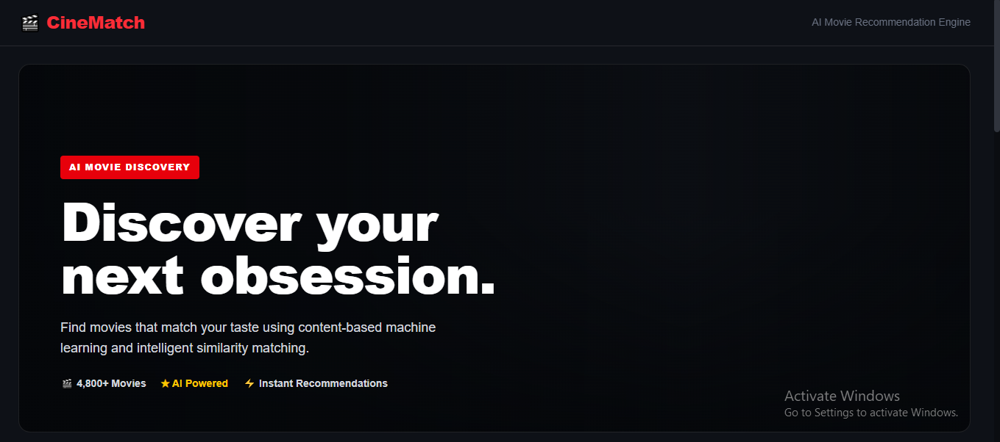
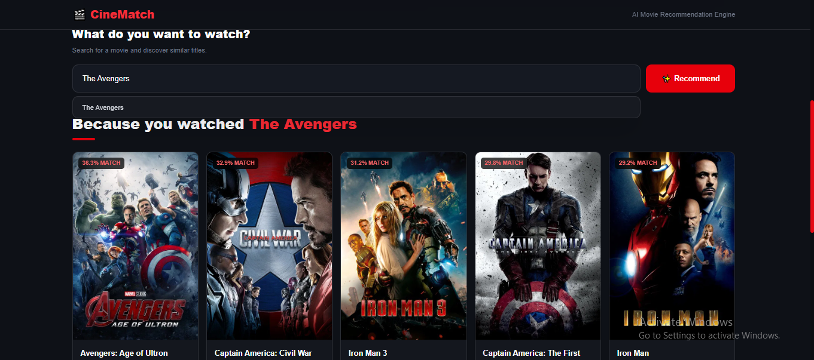
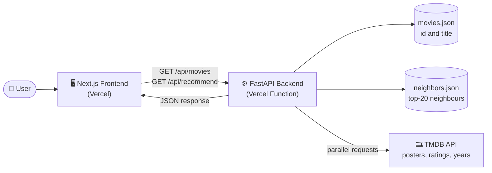
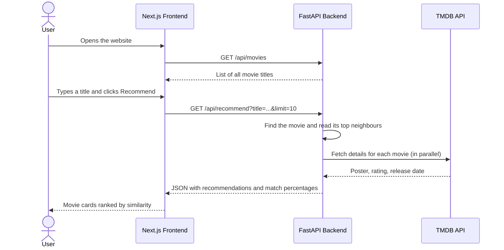
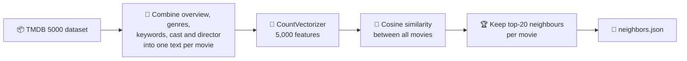

<div align="center">

# 🎬 CineMatch

### AI-Powered Movie Recommendation System

Pick a movie you love and discover similar titles, ranked by a content-based machine learning model.

[](https://movie-recommendation-system36.vercel.app/)


</div>

---

## 📑 Table of Contents

- [🎯 Problem Statement](#-problem-statement)
- [💡 Solution](#-solution)
- [✨ Key Features](#-key-features)
- [📸 Screenshots](#-screenshots)
- [🧰 Tech Stack](#-tech-stack)
- [🧩 Architecture](#-architecture)
- [🔄 Workflow](#-workflow)
- [🧠 How It Works](#-how-it-works)
- [📂 Project Structure](#-project-structure)
- [🔌 API Reference](#-api-reference)
- [💻 Getting Started](#-getting-started)
- [🚀 Deployment](#-deployment)
- [📢 Disclaimer](#-disclaimer)
- [🔮 Future Improvements](#-future-improvements)
- [🙏 Acknowledgements](#-acknowledgements)
- [👤 Author](#-author)
- [📄 License](#-license)

---

## 🎯 Problem Statement

With thousands of movies available on streaming platforms, viewers spend more time **searching for something to watch** than actually watching it. Scrolling through endless catalogues is tiring, and generic "top 10" lists ignore what a person already enjoys.

A good recommender should answer one simple question: **"I liked this movie, what else should I watch?"**

---

## 💡 Solution

**CineMatch** answers that question with a **content-based recommendation engine**. It compares the *content* of movies (plot, genres, keywords, cast and director) and returns the most similar titles, each with a **match percentage**, poster, rating and release year.

The system is a full-stack web application:

- a **Next.js** frontend for a fast, responsive dark-themed interface
- a **FastAPI** backend that serves recommendations
- a **machine learning model** (CountVectorizer + cosine similarity) built on the TMDB 5000 Movies dataset
- the **TMDB API** to enrich results with posters, ratings and release years in real time

---

## ✨ Key Features

| | Feature | Description |
|---|---|---|
| 🔎 | **Search with suggestions** | Type a title and see matching movies from a catalogue of 4,800+ titles |
| 🎯 | **Match percentage** | Every recommendation shows how similar it is to the selected movie |
| 🖼️ | **Rich movie cards** | Poster, title, rating and release year fetched live from TMDB |
| ⚡ | **Fast responses** | Similarity is precomputed, and TMDB details are fetched in parallel and cached |
| 📱 | **Responsive dark UI** | Adaptive grid (2 to 5 columns) built with Tailwind CSS |
| 🛡️ | **Graceful error handling** | Clear messages for unknown titles or an unreachable server |
| 🧪 | **Automated tests** | API endpoints covered with pytest |
| 🔐 | **Secure configuration** | API keys live in environment variables, never in the repository |

---

## 📸 Screenshots

### Home page


### Search and recommendations


---

## 🧰 Tech Stack

| Layer | Technologies |
|---|---|
| **Frontend** |     |
| **Backend** |    |
| **Machine Learning** |    |
| **Data and APIs** |   |
| **Testing** |  |
| **Deployment and Tools** |    |

---

## 🧩 Architecture



**Two independent Vercel deployments** from one repository:

| Part | Folder | Responsibility |
|---|---|---|
| Frontend | `frontend/` | UI, search box, recommendation grid |
| Backend | `backend/` | Recommendation lookup, TMDB enrichment, REST API |

---

## 🔄 Workflow

What happens from the moment a user opens the site:



---

## 🧠 How It Works

The recommendation model is built **offline** once, and the results are served instantly at request time.



1. **Feature engineering:** each movie's overview, genres, keywords, cast and director are merged into a single `tags` text.
2. **Vectorization:** `CountVectorizer` (5,000 features, English stop words removed) converts the text into numerical vectors.
3. **Similarity:** **cosine similarity** measures how close any two movies are in that vector space.
4. **Compression:** only the **top-20 neighbours** per movie are stored (about 1.5 MB), instead of the full 4,803 × 4,803 matrix (about 180 MB).
5. **Serving:** the API reads the precomputed neighbours, adds poster, rating and year from TMDB, and returns JSON.

### Engineering decisions

| Challenge | Decision |
|---|---|
| The full similarity matrix is too large for GitHub and free hosting | Precompute and store only the top-20 neighbours per movie |
| Pickle files are heavy to load and unsafe to trust | Serve plain JSON, so the API needs no pandas, NumPy or scikit-learn at runtime |
| Ten sequential TMDB calls made each request slow | Fetch them concurrently with a thread pool and cache successful results |
| API keys must never be public | `.env` is git-ignored, and secrets live in Vercel environment variables |
| Frontend and backend are deployed separately | CORS is configurable through the `ALLOWED_ORIGINS` environment variable |

---

## 📂 Project Structure

```
Movie_Recommendation_System/
├── backend/
│   ├── main.py                  # FastAPI application
│   ├── requirements.txt         # Runtime dependencies
│   ├── requirements-dev.txt     # Extra tools to rebuild the model and run tests
│   ├── .env.example             # Environment variable template
│   ├── .vercelignore            # Files excluded from the Vercel bundle
│   ├── data/
│   │   ├── movies.json          # Movie ids and titles (used by the API)
│   │   ├── neighbors.json       # Top-20 similar movies per movie (used by the API)
│   │   └── source/movies.pkl    # Processed dataset used to rebuild the model
│   ├── scripts/
│   │   └── build_model.py       # Regenerates movies.json and neighbors.json
│   └── tests/
│       └── test_api.py          # API tests
│
├── frontend/
│   ├── app/                     # Next.js app router (page, layout, global styles)
│   ├── components/              # Hero, MovieSearch, MovieGrid, MovieCard
│   ├── .env.example             # Frontend environment template
│   └── package.json
│
├── docs/
│   └── screenshots/             # Images used in this README
├── .gitignore
└── README.md
```

---

## 🔌 API Reference

Base URL: `https://YOUR-BACKEND-URL.vercel.app` (interactive Swagger docs at `/docs`)

| Method | Endpoint | Description |
|---|---|---|
| `GET` | `/api/health` | Service status, number of movies loaded, and whether TMDB is enabled |
| `GET` | `/api/movies` | Sorted list of all movie titles |
| `GET` | `/api/recommend?title=Avatar&limit=10` | Recommendations for a movie. `limit` ranges from 1 to 20. Returns `404` for unknown titles |

**Example response (shortened)** for `/api/recommend?title=The Avengers&limit=2`:

```json
{
  "selected_movie": "The Avengers",
  "recommendations": [
    {
      "movie_id": 99861,
      "title": "Avengers: Age of Ultron",
      "poster_url": "https://image.tmdb.org/t/p/w500/....jpg",
      "backdrop_url": "https://image.tmdb.org/t/p/original/....jpg",
      "release_year": "2015",
      "rating": 7.3,
      "match_percentage": 36.3,
      "overview": "..."
    }
  ]
}
```

---

## 💻 Getting Started

### Prerequisites

- Python 3.11 or newer
- Node.js 20 or newer
- A free [TMDB API key](https://www.themoviedb.org/settings/api)

### 1. Clone the repository

```bash
git clone https://github.com/abrar35-cyber/Movie_Recommendation_System.git
cd Movie_Recommendation_System
```

### 2. Run the backend

```bash
cd backend
python -m venv venv
venv\Scripts\activate            # macOS/Linux: source venv/bin/activate
pip install -r requirements-dev.txt
cp .env.example .env             # Windows: copy .env.example .env, then add your TMDB key
uvicorn main:app --reload
```

The API runs at http://127.0.0.1:8000, with docs at http://127.0.0.1:8000/docs.

### 3. Run the frontend

```bash
cd frontend
npm install
cp .env.example .env.local       # Windows: copy .env.example .env.local
npm run dev
```

Open http://localhost:3000.

### 4. Run the tests

```bash
cd backend
pytest
```

### 5. Rebuild the recommendation model (optional)

```bash
cd backend
python scripts/build_model.py
```

### Environment variables

| Variable | Used by | Description |
|---|---|---|
| `TMDB_API_KEY` | Backend | TMDB API key. Without it the API still works but returns no posters |
| `ALLOWED_ORIGINS` | Backend (optional) | Comma-separated frontend URLs allowed by CORS. Defaults to any origin |
| `NEXT_PUBLIC_API_URL` | Frontend | URL of the deployed backend, without a trailing slash |

---

## 🚀 Deployment

Both parts are deployed on **Vercel** (free tier) as two projects from this repository:

1. **Backend:** import the repo, set **Root Directory** to `backend`, and add `TMDB_API_KEY`. Vercel detects FastAPI automatically because `main.py` exposes `app`.
2. **Frontend:** import the repo again, set **Root Directory** to `frontend`, and add `NEXT_PUBLIC_API_URL` with the backend URL.

🌐 **Live site:** https://movie-recommendation-system36.vercel.app/

---

## 📢 Disclaimer

- This is a **learning and portfolio project**, not a commercial product.
- Recommendations are **content-based**: they reflect similarity of plot, genre, cast and keywords, not personal taste, popularity or viewing history, so some suggestions may not match your preferences.
- The model uses a **static dataset snapshot**, so recent releases may be missing.
- Movie posters and metadata belong to their respective owners and are provided by TMDB.
- The app runs on free hosting tiers, so the first request after a period of inactivity can be slightly slower.
- *This product uses the TMDB API but is not endorsed or certified by TMDB.*

---

## 🔮 Future Improvements

- [ ] Hybrid recommendations (TF-IDF or sentence embeddings combined with genres and ratings)
- [ ] Filters by genre, release year and rating
- [ ] Movie detail page with overview, cast and trailer
- [ ] User watchlist and personalised suggestions
- [ ] GitHub Actions workflow to run tests on every push

---

## 🙏 Acknowledgements

- [TMDB 5000 Movie Dataset](https://www.kaggle.com/datasets/tmdb/tmdb-movie-metadata) on Kaggle
- [The Movie Database (TMDB)](https://www.themoviedb.org/) for posters, ratings and metadata
- [FastAPI](https://fastapi.tiangolo.com/), [Next.js](https://nextjs.org/), [scikit-learn](https://scikit-learn.org/) and [Tailwind CSS](https://tailwindcss.com/)

---

## 👤 Author

**Abrar Ahmed**

[](https://github.com/abrar35-cyber)
[](https://www.linkedin.com/in/abrarahmedsoomro/)
[](https://www.kaggle.com/abrarahmed35)

---

## 📄 License

Released under the [MIT License](https://opensource.org/licenses/MIT).

<div align="center">

⭐ If you found this project useful, consider giving it a star!

</div>
